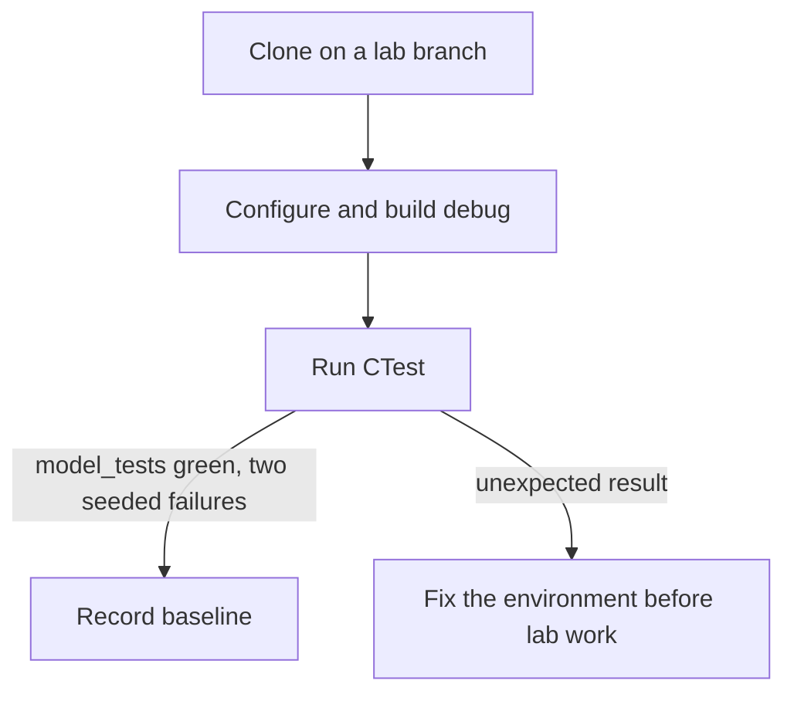

# 3. Verifying the Environment

!!! abstract "About this Guide"
    - Clone the repository, build it, and record the baseline behavior.
    - This check proves that any later failure comes from your changes, not from a broken workstation.

## 1. Clone the Repository



```sh
git clone https://github.com/nirgeier/Copilot-Cpp-Workshop.git
cd Copilot-Cpp-Workshop
git checkout -b lab/my-name
```

!!! tip "Approved Git flow"
    - Use your organization's Git process if cloning through a proxy or mirror is required.
    - Do not substitute a random external repository for the workshop material.

## 2. Configure and Build

```sh
cmake --preset debug
cmake --build --preset debug
```

- `compile_commands.json` is generated in `build/debug/`.
- Point the VS Code C/C++ extension at it so Copilot sees the same flags the compiler uses.

## 3. Run the Tests

```sh
ctest --preset debug --output-on-failure
```

| CTest entry | Expected on a clean checkout |
|-------------|------------------------------|
| `model_tests` | Pass |
| `preprocessing_tests` | Fail in `NormalizesToUnitRange` |
| `postprocessing_tests` | Fail in `ArgmaxIncludesFirstClass` |

!!! warning "`No tests were found` is a failure"
    - CTest must discover all three entries.
    - If it reports no tests, stop and fix the configure step before continuing.

## 4. Run the CLI and the Benchmark

```sh
./build/debug/edge_inference_cli data/valid.json
./build/debug/edge_inference_cli data/invalid.json
./build/debug/edge_benchmark data/valid.json 500
```

- The valid sample prints three confidence ordered classes.
- The invalid sample contains `1e309` and must be rejected with an error and a non-zero exit code.
- The benchmark prints `p50_ms` and `p95_ms`.

## 5. Optional Sanitizer Check

```sh
cmake --preset sanitizers
cmake --build --preset sanitizers
ctest --preset sanitizers --output-on-failure
```

- The same two tests fail under sanitizers.
- No sanitizer report should appear.

## Reference

### Validation command reference

| Command | Preset | Expected baseline |
|---------|--------|-------------------|
| `cmake --preset debug` | debug | Configure succeeds, `compile_commands.json` is generated |
| `cmake --build --preset debug` | debug | Build succeeds |
| `ctest --preset debug --output-on-failure` | debug | `model_tests` passes, two seeded tests fail |
| `cmake --preset sanitizers` | sanitizers | Configure succeeds where sanitizers exist |
| `ctest --preset sanitizers --output-on-failure` | sanitizers | Same two failures, no sanitizer report |

- `No tests were found` means the configure step failed. Fix it before continuing.
- The two failing entries are deliberate starting points for Lab 2 and Lab 3, not a broken workstation.
- The CLI reads `data/valid.json` and rejects `data/invalid.json`, which contains `1e309`.

!!! note "Evidence to keep"
    - Record compiler and CMake versions, the CTest summary line, the invalid input error, and the benchmark output.
    - Paste these exact outputs into chat later instead of describing them.

---

## 6. Record Your Baseline

Save the following in your notes:

- Compiler and CMake versions
- The CTest summary line
- The invalid-input error message
- The benchmark output

## Example

```text
$ ctest --preset debug --output-on-failure
1/3 Test #1: preprocessing_tests ..........***Failed
  error: check std::fabs(*bounds.first - 0.0f) < 1e-5f has failed
2/3 Test #2: postprocessing_tests .........***Failed
  error: check best.label == 0u has failed [1 != 0]
3/3 Test #3: model_tests ...................   Passed

33% tests passed, 2 tests failed out of 3
```

This is the expected baseline. A clean checkout builds, and the two failures
are the starting points for the debugging and review tasks.

---

**Next:** [Lab 01: Copilot Foundations](../01-Copilot-Foundations/README.md)
