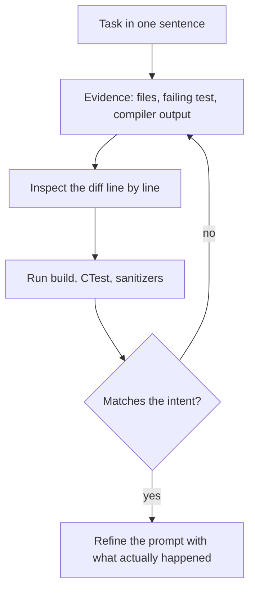

# 2. Context Engineering

!!! abstract "About this Guide"
    - Context engineering is the practice of giving Copilot the smallest sufficient evidence for a task.
    - More context is not always better; deliberate boundaries produce better C++ changes.

## 1. The Engineer-AI Feedback Loop



1. Define the task in one sentence.
2. Provide evidence: the exact files, the failing test, the compiler output.
3. Inspect the diff line by line.
4. Run the checks: build, CTest, and sanitizers where available.
5. Refine the prompt with what actually happened.

!!! tip "Grounding beats length"
    A short prompt with `tests/test_preprocessing.cpp`, `src/preprocessing.cpp`, and the failing assertion is more useful than a long description of the repository.

## 2. Layering Instructions

| Layer | Location in this repository | Scope |
|-------|------------------------------|-------|
| Repository wide | `.github/copilot-instructions.md` | Every Copilot interaction here |
| Path specific | `.github/instructions/cpp.instructions.md` | `**/*.cpp`, `**/*.hpp` |
| Path specific | `.github/instructions/cmake.instructions.md` | `**/CMakeLists.txt` |
| Agent facing | `AGENTS.md` | All coding agents, not just Copilot |

- Path rules use `applyTo` glob patterns. Keep them narrow.
- `AGENTS.md` is shared across tools. Put durable project facts there, not tool-specific syntax.
- Personal and organization instructions combine with repository files. Repository rules are the ones you can review and version.

## 3. Reusable Prompt Files

- Prompt files are `*.prompt.md` under `.github/prompts/`.
- Frontmatter declares `description`, `agent`, and optional model and tools.
- Invoke them with `/` in chat.

| Prompt in this repository | Purpose |
|---------------------------|---------|
| `plan-implementation.prompt.md` | Turn an issue into a repository-grounded plan |
| `review-diff.prompt.md` | Review the current diff against the C++ checklist |
| `generate-tests.prompt.md` | Add focused Boost.Test cases |

## 4. C++ Grounding That Pays Off

- Give the exact build and test commands from `CMakePresets.json`.
- Mention the formatter and warning policy: `-Wall -Wextra -Wpedantic` or `/W4`.
- Point to the header before the source so Copilot respects the public interface.
- Include the failing Boost.Test output instead of describing the failure.

!!! warning "Context drift"
    - In long sessions, Copilot can lose track of earlier constraints.
    - Refresh context by restating the acceptance criteria and the validation gates before each new task.

## Reference

### Instruction layer reference

Layers combine. Only the repository files are reviewable in a pull request.

| Layer | File or location here | Scope | Frontmatter key |
|-------|-----------------------|-------|-----------------|
| Repository instructions | `.github/copilot-instructions.md` | Every interaction here | None |
| Path instructions | `.github/instructions/*.instructions.md` | `applyTo` globs | `applyTo` |
| Agent facing rules | `AGENTS.md` | All coding agents | None |
| Prompt file | `.github/prompts/*.prompt.md` | Invoked task | `description`, `agent`, optional model and tools |
| Space | Copilot Chat | Curated shared sources | Not a file |

- Put durable project facts in `AGENTS.md`, not tool specific syntax.
- Keep `applyTo` globs narrow. A broad glob makes a rule apply everywhere.

```yaml
---
applyTo: "**/*.cpp, **/*.hpp"
---
```

!!! note "Context drift"
    - Restate acceptance criteria and validation gates before each new task in a long session.
    - More context is not better. Name the exact files and the failing output.

---

## 5. Copilot Spaces

- A Space is a curated collection of code, documents, and specifications used as shared team context.
- Useful for holding the syllabus, the review checklist, and the repository together during a workshop.
- Treat content in a Space like code: review it and keep it current.

## Example

```markdown
---
applyTo: "tests/**"
---

# Test rules for edge_inference

- Use Boost.Test in header-only mode. Do not add a test framework.
- Add one assertion that proves the reported behavior.
- Never delete, skip, or weaken an assertion to get a green run.
```

## 6. Summary

Choose context deliberately and set boundaries<br>
Explain the difference between repository, path, and agent instructions<br>
Use a prompt file for a repeatable workflow

---

**Next:** [3. Custom Agents and Skills](03-Custom-Agents-and-Skills.md)
