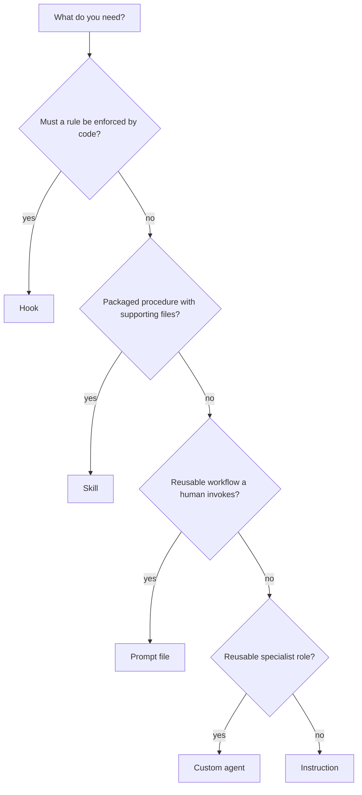

# 3. Custom Agents, Agent Skills and Hooks

!!! abstract "About this Guide"
    - Instructions say what to do.
    - Agents, skills, and hooks shape who does it, what they may touch, and what checks run around them.
    - Choose the smallest primitive that solves the problem.

## 1. Custom Agents

- Stored as `.github/agents/*.agent.md`.
- Frontmatter declares a description, allowed tools, and an optional preferred model.
- This repository ships `cpp-reviewer.agent.md` with a narrow checklist.

!!! tip "Role agents worth defining"
    | Role | Responsibility |
    |------|----------------|
    | Planner | Produce a plan without editing files |
    | Implementer | Make one scoped change and run local checks |
    | Test author | Add Boost.Test cases only |
    | Reviewer | Review a diff, never implement it |
    | Security auditor | Check policies, secrets, and tool scope |

## 2. A C++ Reviewer You Can Trust

The reviewer agent checks:

- Ownership and lifetimes, including exception safety
- Bounds, signedness, and integer width
- Exception safety and stable API boundaries
- Invented or unsupported APIs
- Tests that were weakened instead of fixed

!!! warning "Review the reviewer"
    - An agent with write access can quietly change the code it is reviewing.
    - Keep the reviewer's tool set narrow and have a human approve the final diff.

## 3. Agent Skills

- A skill is a folder with `SKILL.md`, optional scripts, and resources.
- Copilot loads it on demand when the task matches the description.
- This repository includes `add-boost-test-suite/SKILL.md`, which encodes the local procedure for adding a test.

| Primitive | Best for |
|-----------|----------|
| Instructions | Standing rules that always apply |
| Prompt file | A repeatable user invoked workflow |
| Custom agent | A role with a specific tool scope |
| Skill | A packaged procedure with supporting files |
| Hook | A deterministic check around an agent action |

## 4. Hooks

- Hooks run deterministic checks around agent actions: format, lint, policy checks, audit logging.
- They are a guardrail, not a replacement for tests.
- Keep hook output visible so participants can see why an action was blocked.

## Choosing a Primitive



## Reference

### Customization primitive reference

| Primitive | File | Frontmatter keys | Loaded when |
|-----------|------|------------------|-------------|
| Instruction | `.github/copilot-instructions.md`, `AGENTS.md` | None | Always in scope |
| Path instruction | `.github/instructions/*.instructions.md` | `applyTo` | A matching file is in context |
| Prompt file | `.github/prompts/*.prompt.md` | `description`, `agent` | The user invokes it |
| Custom agent | `.github/agents/*.agent.md` | `description`, `tools`, optional model | The role is selected |
| Skill | `.github/skills/<name>/SKILL.md` | `name`, `description`, optional `license`, `compatibility`, `metadata`, `allowed-tools` | The description matches the task |
| Hook | `.github/hooks/*.json` | `version`, `hooks` | The configured event fires |

- Choose the smallest primitive that solves the problem.
- A reviewer with an edit tool can change the code it reviews. Keep write tools out of review roles.
- Hooks enforce a rule by running code. Instructions only request it.

!!! note "Availability"
    - Frontmatter keys and tool identifiers differ across the IDE, CLI, and cloud agent.
    - Check the customization cheat sheet and the configuration reference for your surface before relying on a field.

---

## 5. Handoffs

- A typical chain is Plan, then Implement, then Review.
- Each handoff should carry the issue reference, the acceptance criteria, and the validation evidence.
- Version-control these customizations like any other code and review changes to them.

## Example

A complete skill at `.github/skills/cpp-api-check/SKILL.md`:

```markdown
---
name: cpp-api-check
description: Verify that a proposed C++ change uses only APIs that exist in this repository. Use when reviewing a diff that adds or changes a call.
---

# C++ API check

1. Read the diff and list every new function or type name.
2. Find each name in a header under `include/edge_inference/` or in an
   included standard header.
3. Mark each name as found, invented, or uncertain.
4. For invented names, replace them with an API that exists in the headers.
5. Output: a table of name, header, verdict, and evidence line.

## Rules

- Do not invent STL or third party APIs.
- Do not add a dependency or a network download.
- Keep prose in ASCII hyphens.
```

## 6. Summary

&emsp;✅&emsp;Choose between instructions, prompts, agents, and skills deliberately<br>
&emsp;✅&emsp;Scope an agent's tools to its role<br>
&emsp;✅&emsp;Package a repeatable C++ procedure as a skill

---

**Next:** [4. Customize Copilot](04-Lab-1-Customize-Copilot.md)
