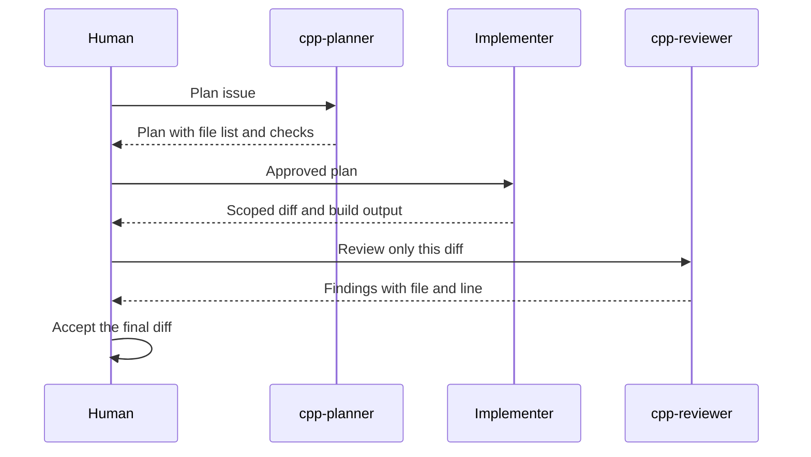

# 6. Custom Agents

!!! abstract "About this Lab"
    - A custom agent defines a role with its own instructions and tool scope.
    - Built-in agents and reviewer personas differ in what they may read and change.


## 1. Agent Profiles



- A custom agent is a Markdown file with YAML frontmatter.
- It describes the role, gives instructions, and can restrict the available tools.
- In some environments it can also configure MCP servers for that agent.

- Repository profiles live in `.github/agents/*.agent.md`.
- Profiles can also be shared at organization and enterprise level. Copilot CLI supports personal profiles.
- Define a role once instead of repeating its instructions in every session.
- Use a custom agent for a reusable role. Use a skill for a packaged procedure.

| Role | Read | Write | Run commands |
|------|------|-------|--------------|
| Planner | Yes | No | No |
| Implementer | Yes | Yes | Yes, approved |
| Test author | Yes | Tests only | Build and test |
| Reviewer | Yes | No | No |
| Security auditor | Yes | No | Read-only checks |

!!! tip "Custom agent versus subagent"
    - A custom agent is a definition of a specialist.
    - A subagent is an agent doing delegated work in a separate context window.
    - The main agent can delegate to a built-in agent or to a custom profile.
    - You do not need a custom profile to use subagents.

## 2. Built-in Agents

- Copilot CLI ships built-in agents that do not need to be authored.
- Common ones include `explore`, `task`, `general-purpose`, `code-review`, `research`, `rubber-duck`, and `security-review`.
- Their tools and model defaults differ by agent.
- Check the CLI reference before relying on one for a gate.

The `rubber-duck` agent is useful for a second opinion when a fix feels plausible but unproven.

## Reference

### Agent profile frontmatter reference

| Field | Required | Values | Effect |
|-------|----------|--------|--------|
| `description` | Yes | Short role description | Selects the agent deliberately |
| `tools` | No | Tool names, list or space separated | Restricts what the agent can do |
| `model` | No | Model identifier | Preferred model for the role |
| MCP servers | No | Surface specific property | Adds tools to one cloud agent profile |

- A reviewer needs read and search only. Remove `edit` from `cpp-reviewer.agent.md`.
- A planner needs read and search only. It must not run mutating commands.
- A test author may edit tests and run the build and test commands.
- A custom agent is a role definition. A subagent is delegated work in a separate context.

```yaml
---
description: Produce a repository-grounded implementation plan for a C++ task without editing files
tools: ["codebase", "search"]
---
```

!!! note "Tool names vary by surface"
    - Tool identifiers and frontmatter keys are not identical across IDE, CLI, and cloud agent.
    - Verify against the configuration reference for the surface you use.

---

## Example

The planner profile from section 4 in short form:

```markdown
---
description: Produce a repository-grounded implementation plan for a C++ task without editing files
tools: ["codebase", "search"]
---

# C++ planner

You plan. You do not edit files and you do not run mutating commands.
Output: scope, file list, steps, checks, risks.
```

## 3. Summary

&emsp;✅&emsp;Define a role with a narrow tool set<br>
&emsp;✅&emsp;Distinguish an agent profile from a subagent<br>
&emsp;✅&emsp;Run a plan, implement, review handoff with evidence at each step

---

**Next:** [7. Choosing the Right Model](07-Lab-Choosing-the-Right-Model.md)
