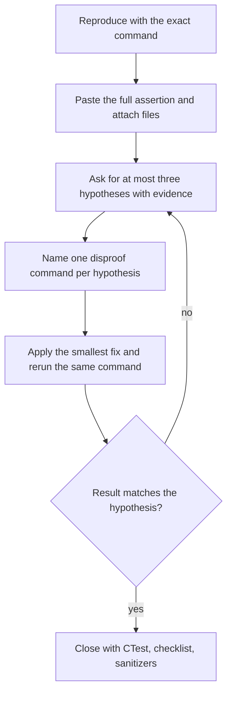

# 8. Debugging with Copilot

!!! abstract "About this Lab"
    - Copilot is most useful in a debug loop when it receives real compiler and test output.
    - Evidence sources in this repository keep that loop grounded.


## 1. Ground the Debug Loop



1. Reproduce the failure with the exact command.
2. Paste the full error or assertion, not a paraphrase.
3. Attach the header and source with `#file` or `@` references.
4. Ask for at most three hypotheses with evidence for each.
5. Pick one hypothesis, make the smallest change, rerun the same command.
6. If the result contradicts the hypothesis, discard it and refresh context.

!!! tip "Real output beats description"
    - "The test fails" produces guesses.
    - A Boost.Test assertion with file, line, and expected versus actual values produces a grounded answer.
    - Paste the terminal block.

## 2. Evidence Sources in This Repository

| Source | Command or file | Use it for |
|--------|-----------------|------------|
| Compiler errors | `cmake --build --preset debug` | Signature and type mismatches |
| Test failures | `ctest --preset debug --output-on-failure` | Seeded defects |
| Sanitizers | `cmake --preset sanitizers` and build and test | UB and memory errors |
| Compile database | `build/debug/compile_commands.json` | Exact include paths and flags |
| Public contract | `include/edge_inference/*.hpp` | Intended behavior |
| Review rules | `docs/review-checklist.md` | What a fix must respect |

## Reference

### Debug evidence reference

| Evidence | Source | Use it to prove |
|----------|--------|-----------------|
| Boost.Test assertion | `ctest --preset debug --output-on-failure` | Expected versus actual at file and line |
| Compiler diagnostic | `cmake --build --preset debug` | Type and signature mismatch |
| Sanitizer report | `ctest --preset sanitizers --output-on-failure` | Undefined behavior or memory error |
| Compile database | `build/debug/compile_commands.json` | Real include paths and warning flags |
| Public contract | `include/edge_inference/*.hpp` | Intended behavior |
| Review checklist | `docs/review-checklist.md` | What a fix must respect |

- Ask for at most three hypotheses, each tied to a line, plus one command that would disprove it.
- Reject any fix that deletes an assertion or changes an expected value without a contract change.
- Rerun the same command after each change so the before and after outputs are comparable.

```text
Given this Boost.Test failure and src/preprocessing.cpp, list three
hypotheses with file and line evidence. For each, name the command that
would disprove it. Do not edit files.
```

!!! note "Second opinion"
    - Use a skill for the repeatable test addition and a second opinion agent to argue against the fix.
    - A passing test is not approval of ownership, ABI, or policy.

---

## 3. Anti-Patterns

| Anti-pattern | Why it fails |
|--------------|--------------|
| Describing the error in your own words | Introduces assumptions Copilot then follows |
| Asking "fix it" with no scope | Invites broad edits and weakened tests |
| Accepting the first plausible patch | Plausible is not proven |
| Long session without restating constraints | Context drift drops the validation gates |
| Treating a passing test as approval | Tests do not cover ownership, ABI, or policy |

## Example

```text
Prompt: Triage this failure without editing. Three hypotheses, each with
file and line, and one disproof command each.

Pasted evidence:
tests/test_preprocessing.cpp:23
error: check std::fabs(*bounds.first - 0.0f) < 1e-5f has failed

Disproof command for "normalization is missing":
ctest --preset debug --output-on-failure -R preprocessing_tests
```

## 4. Summary

&emsp;✅&emsp;Feed exact build and test output into the debug loop<br>
&emsp;✅&emsp;Demand hypotheses and disproof commands before edits<br>
&emsp;✅&emsp;Close with CTest, review checklist, and sanitizers where available

---

**Next:** [9. Reviewing Copilot Usage Internally](09-Lab-Reviewing-Copilot-Usage-Internally.md)
