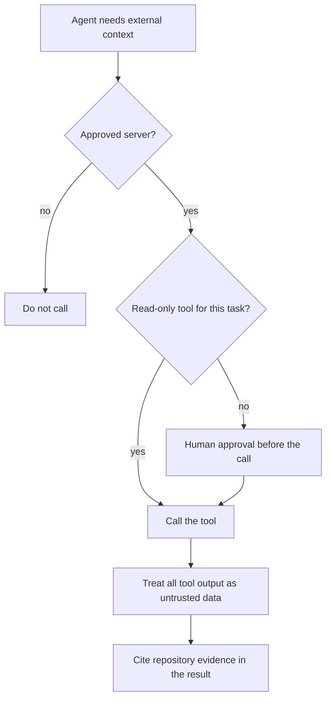

# 12. MCP and Connectors

!!! abstract "About this Lab"
    - MCP connects Copilot to external tools and data sources.
    - Connectors and custom servers differ in where they are configured and what they can access.


!!! note "Latest changes"
    The November 2026 releases added new models, connectors, review controls, and monitoring. See [20. Latest Copilot Changes](20-Latest-Copilot-Changes.md) for the current status.

## 1. What MCP Adds



- Model Context Protocol is an open standard for connecting AI applications to data sources and tools.
- MCP complements prompts, files, and instructions.
- It adds connections, it does not replace guidance about how the agent should work.

Example for this workshop: connect an issue tracker so Copilot reads the issue while fixing it, instead of you pasting the issue text into chat.

| Surface | Configuration note |
|---------|--------------------|
| Copilot app | Repository or local configuration, plus Customize tab discovery |
| Copilot CLI | Local and remote servers, GitHub MCP server built in |
| Cloud agent and code review | Repository settings on github.com, applies to automations too |
| IDEs | VS Code, Visual Studio, JetBrains, Xcode, Eclipse with surface specific setup |

## 2. Connectors vs Custom Servers

- A **connector** is a GitHub verified MCP server. Configure it once and use it across supported surfaces, including cloud sandboxes. GitHub handles configuration and authentication.
- A **personal MCP server** is for your own workflow across repositories. In cloud sandboxes it supports key based authentication only, with secrets prefixed `COPILOT_MCP_`.
- A **repository level server** is shared by collaborators with write access. Use a service account, not personal credentials.
- An agent profile can define MCP servers for one custom agent in Copilot cloud agent. That property is not used by agents running directly in IDEs.

!!! note "Precedence and limits"
    - Later configurations override earlier ones for cloud agent: defaults, then custom agent profiles, then repository settings.
    - Repository settings win over a personal server with the same name.
    - GitHub documents a limit of 50 MCP servers across personal and repository configuration.

## 3. Defaults Worth Knowing

- Copilot cloud agent starts with the GitHub server and the Playwright server.
- The GitHub server uses a scoped, read only token for the current repository by default. Broader access needs explicit credentials.
- Playwright can only reach `localhost` and `127.0.0.1` in the agent environment by default.
- Code review supports MCP tools only, not resources or prompts.
- Code review excludes tools that do not declare `annotations.readOnlyHint: true`.
- Cloud agent and code review do not support remote OAuth servers configured in repository settings or agent profiles.
- Organization policy can disable MCP for Business and Enterprise users. Individual plans are not governed by that policy.

!!! warning "Autonomous tool use"
    - When you delegate by `@copilot` mention or by assigning an issue, Copilot uses configured MCP tools without asking for approval before each call.
    - Review every server and allow only the tools the task needs.

## Reference

### MCP configuration reference

| Server kind | Configuration location | Authentication | Scope |
|-------------|------------------------|----------------|-------|
| Connector | GitHub account or organization settings | Handled by GitHub | Across supported surfaces |
| Personal MCP server | User configuration | Keys prefixed `COPILOT_MCP_` in cloud sandboxes | Your work across repositories |
| Repository level server | Repository settings | Service account | Collaborators with write access |
| Agent profile server | Custom agent profile | Surface specific | One cloud agent role |

- Precedence for cloud agent: defaults, then custom agent profiles, then repository settings.
- Repository settings win over a personal server with the same name.
- GitHub documents a limit of 50 MCP servers across personal and repository configuration.
- Code review uses only tools that declare `annotations.readOnlyHint: true`.

```text
List the tools exposed by this MCP server. Mark each read or write.
Use only the read-only issue and search tools to find issue #1.
```

!!! note "Trust boundary"
    - Tool output is untrusted input. An issue body or comment can try to steer the agent.
    - Keep write tools out of review paths and keep a human approval step for mutations.

---

## Example

```json
{
  "servers": {
    "github": {
      "type": "http",
      "url": "https://api.githubcopilot.com/mcp/"
    }
  }
}
```

Enable only issue read and code search for the first task. Add credentials
through the approved store, never in the file.

## 4. Summary

&emsp;✅&emsp;Explain what MCP adds and where each configuration lives<br>
&emsp;✅&emsp;Distinguish connectors, personal servers, and repository servers<br>
&emsp;✅&emsp;Grant the smallest tool set and assume tool output is untrusted

**Next:** [13. Agent Mode and Plan Mode](13-Lab-Agent-Mode-and-Plan-Mode.md)
