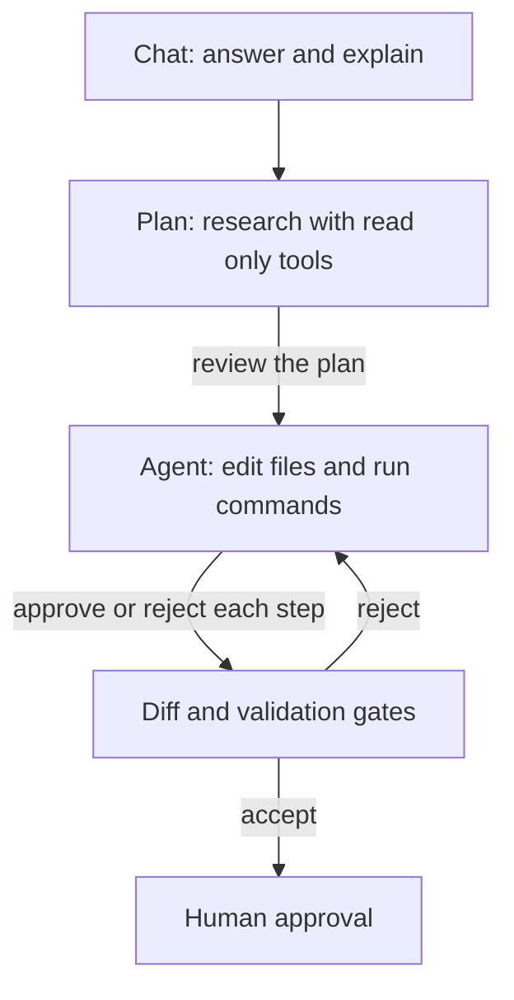

# 13. Agent Mode and Plan Mode

!!! abstract "About this Lab"
    - Mode selection determines whether Copilot plans, edits, or keeps working across turns.
    - Approvals and permissions decide which actions need a human.


## 1. Three Ways to Work



| Mode | Copilot does | You do |
|------|--------------|--------|
| Chat | Answers and explains | Read and decide |
| Plan | Researches with read only tools and drafts a plan | Review and approve the plan |
| Agent | Chooses files, edits, and runs commands | Approve commands, review each edit |

!!! tip "Plan first when the task is large or ambiguous"
    - The plan agent uses read only tools and codebase analysis.
    - It does not change code until you approve the plan.
    - In VS Code and JetBrains you can then choose **Start Implementation** or **Open in Editor** to save the plan as Markdown.

- Plan mode is available in VS Code, JetBrains IDEs, Xcode, and Eclipse, but not Visual Studio at the time of writing.
- Agent mode is available in VS Code, Visual Studio 17.14 and later, JetBrains IDEs, Xcode, and Eclipse.

## Reference

### Mode and approval reference

| Mode | Tools | Plan before edits | Available in |
|------|-------|-------------------|--------------|
| Chat | Read by default | No | All Copilot surfaces |
| Plan | Read only | Yes | VS Code, JetBrains, Xcode, Eclipse |
| Agent | Read and write | Optional | VS Code, Visual Studio 17.14 and later, JetBrains, Xcode, Eclipse |

| Control | Effect |
|---------|--------|
| Tool approval | Confirm each command or edit |
| Auto-approval rules | Skip confirmation for known safe commands only |
| Checkpoints and undo | Roll back an edit after inspection |
| Request limits | Bound credits and run time |

- Start in Plan when the task is ambiguous or spans several files.
- Reject a plan that guesses, omits the failing test, or omits validation commands.

```text
Plan a fix for issue #1. Use read only tools. Name the files to change,
the failing CTest case, and the commands from CMakePresets.json.
State open questions. Do not edit anything.
```

!!! note "Availability"
    - Plan mode is not available in Visual Studio at the time of writing.
    - Administrator and editor settings can allow some commands to run without approval.

---

## Example

```text
Plan a fix for issue #1 in this repository. Use read only tools only.
Find the failing CTest case, read the public header before the source,
name the exact files to change, list the build and test commands from
CMakePresets.json, and state open questions. Do not edit anything.
```

## 2. Summary

&emsp;✅&emsp;Use plan mode to research before any file changes<br>
&emsp;✅&emsp;Steer agent mode with approvals, checkpoints, and bounded scope<br>
&emsp;✅&emsp;Close with the repository validation gates and a diff review

**Next:** [14. Subagents and Delegation](14-Lab-Subagents-and-Delegation.md)
