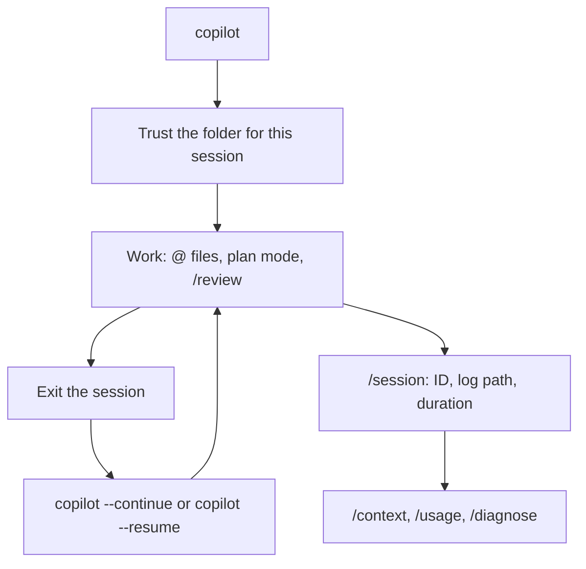

# 15. Copilot CLI

!!! abstract "About this Lab"
    - Copilot CLI brings the same workflows to the terminal.
    - Trust, context references, and approval prompts shape what it can do.


## 1. Useful Commands and Shortcuts



| Action | How |
|--------|-----|
| Stop a running operation | Press Esc twice quickly |
| Toggle plan mode | Shift+Tab |
| Add a file to context | Type `@` and the relative path, then Tab |
| Request a review | `/review` with optional path or prompt |
| Use a built-in agent | Name it in the prompt, such as `rubber-duck` |
| Ask a quick side question | Use the side question command |

- Attachments support images and PDFs with a model that accepts image input.
- They are available on all plans and need no policy to enable.

## 2. Permission Prompts

Tools that modify or execute files can require approval.

- **Yes** allows one use. You will be asked again next time.
- Allow for this location or session saves the approval. An option that says "don't ask again" persists across sessions for that directory.
- **No** stops the operation. You can then tell Copilot what to do differently, including inline feedback about the rejection.

!!! warning "Saved approvals have consequences"
    - Saving an approval for a command such as `rm` allows future deletion in that directory without another prompt.
    - Prefer session scoped approvals during a workshop.

## 3. Resume a Previous Session

Sessions are saved locally and can sync to your GitHub account. Resuming loads the full conversation history, so you continue where you stopped.

| Goal | CLI action |
|------|------------|
| Resume the most recent session | `copilot --continue` |
| Pick a recent session from a list | `copilot --resume` |
| Resume a known session | `copilot --resume SESSION-ID` or `copilot --resume="session name"` |
| Switch sessions inside a session | `/resume` or `/resume SESSION-ID` |
| See the session ID, log path, and duration | `/session` |
| Name a session so it is easy to find | `/rename NEW_NAME` in session, `--name "name"` at startup |
| Browse all local and cloud sessions | Sessions tab with Tab, or `/session` |

- The session picker sorts by relevance to the current directory by default. Other orders are last used, created, and name.
- The Sessions tab searches the full session store and includes cloud and remote sessions. The sidebar shows recent local ones only.
- Cloud sessions appear in the Sessions tab and can be resumed from the CLI with `/resume`.

- [ ] Start a session, run `/session`, and record the session ID and log path.
- [ ] Exit, resume with `copilot --continue`, and confirm the earlier messages are present.
- [ ] Rename the session and find it again with `copilot --resume`.

!!! warning "Sessions contain evidence and sometimes secrets"
    - Session history stores prompts, tool output, and file paths. Review it before sharing.
    - A session does not replace a branch or a commit. Keep lab evidence in files you review.

## 4. Inspect Tokens and Debug Logs

Use these controls when an answer missed context or consumed more credits than expected.

| Question | Command or setting |
|----------|--------------------|
| How much of the context window is used? | `/context` |
| How many tokens and credits did this session use? | `/usage`, per model token totals |
| Where is this session's log file? | `/session` prints the full path |
| Why did the agent do that? | `/diagnose` analyzes the current session log |
| Enable verbose logging | `--log-level debug` or `logLevel: "debug"` in `~/.copilot/settings.json` |
| Change the log directory | `--log-dir DIRECTORY`, default `~/.copilot/logs/` |
| Package logs for troubleshooting | `/collect-debug-logs file [PATH]` |

- Log files are named `process-{timestamp}-{pid}.log`. Enable logging before you reproduce a problem; capture is not retroactive.
- `/context` shows token use in the context window. `/usage` reports per-model token totals and credits where billed.
- `/compact` summarizes history to reduce context use. Restate the acceptance criteria after compacting.

```sh
copilot --log-level debug --log-dir ./lab-logs
```

- [ ] Run `/context` and `/usage` in a lab session and record what each reports.
- [ ] Start a session with `--log-level debug`, then open the log file printed by `/session`.
- [ ] Use `/diagnose` on that log and classify each finding as grounded or speculative.

!!! warning "Logs are sensitive"
    - Debug logs and collected archives can contain prompts, source snippets, paths, and tool output.
    - Review them locally. Never commit them or upload them without approval.

## Reference

### CLI interaction reference

| Action | Control | Scope |
|--------|---------|-------|
| Stop an operation | Esc twice quickly | Current session |
| Toggle plan mode | Shift+Tab | Current prompt or session |
| Attach a file | `@` plus relative path, then Tab | One prompt |
| Review a diff | `/review` with optional path or prompt | Uncommitted changes |
| Sign in | `/login` | Current user |
| Ask a side question | Side question command | Same session, separate thread |
| Name a built-in agent | Agent name in the prompt | One task |
| Resume the latest session | `copilot --continue` | Most recent session for this directory |
| Pick a saved session | `copilot --resume`, or `/resume` in session | Session picker, sorted by relevance |
| Inspect this session | `/session` | ID, working directory, duration, log path |
| Inspect context and tokens | `/context`, `/usage` | Context window and per-model token totals |
| Diagnose and collect logs | `/diagnose`, `/collect-debug-logs file` | Current session log and a local archive |

- Trust is scoped to a directory tree. Prefer session only trust during a workshop.
- `Yes` approves one use. Session or location approvals persist. "Don't ask again" persists across sessions.
- Do not save a persistent approval for a destructive command such as `rm`.

!!! note "Customization is not shared"
    - CLI skills live in `.github/skills` or `~/.copilot/skills`.
    - Hooks live in `.github/hooks/*.json` or `~/.copilot/hooks/*.json`.
    - IDE and cloud configurations are separate. Check each surface before assuming a profile applies.

---

## 5. Customize the CLI

The CLI supports its own customization locations:

| Customization | Typical location |
|---------------|------------------|
| Custom instructions | CLI specific configuration |
| Agent skills | `.github/skills`, `~/.copilot/skills` |
| Custom agents | Repository or personal profiles |
| Hooks | `.github/hooks/*.json`, `~/.copilot/hooks/*.json` |
| MCP servers | CLI configuration, GitHub server built in |

- Configuration is not automatically shared with the IDE or the cloud agent.
- Check the setup guide for the surface before assuming a profile or hook applies.

## Example

```text
$ copilot
? Do you trust the files in this folder? Yes (this session only)

> Using @CMakePresets.json, list the configure presets.
  base (hidden): build/${presetName}, exports compile commands
  debug: Debug build
  release: Release build
  sanitizers: Debug with ENABLE_SANITIZERS=ON

> Press Shift+Tab, then: Plan a fix for postprocessing_tests. Do not edit.
  Plan: read tests/test_postprocessing.cpp and src/postprocessing.cpp,
  name the failing assertion, then run ctest --preset debug --output-on-failure.

> /review src/preprocessing.cpp
  Copilot proposes: git diff -- src/preprocessing.cpp -> Yes
  Comment: missing bounds check (Medium, grounded)

> Use rubber-duck to argue against this diff.
  Finding: the fix changes a public behavior without a contract note.
```

## 6. Summary

&emsp;✅&emsp;Start a CLI session with explicit trust and approval choices<br>
&emsp;✅&emsp;Use `@` context, plan mode, and `/review` in the terminal<br>
&emsp;✅&emsp;Keep CLI customization separate from IDE and cloud configuration

**Next:** [16. Hooks and Guardrails](16-Lab-Hooks-and-Guardrails.md)
