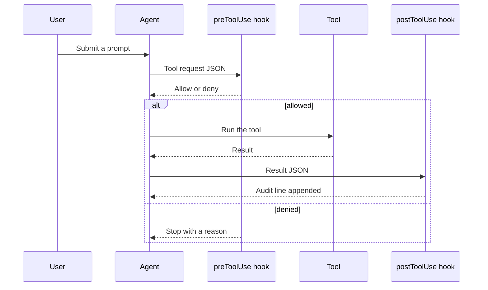

# 16. Hooks and Guardrails

!!! abstract "About this Lab"
    - Hooks run deterministic commands at defined points in an agent workflow.
    - They enforce checks that instructions can only request.

## 1. What Hooks Are



A hook is an external command that Copilot runs at a defined point in an agent session. The point is called an event. Typical events are the start of a session, a submitted prompt, a tool call, and the end of a session.

The hook receives JSON on stdin describing what the agent is about to do or has just done. The script can inspect that JSON and write a decision or extra context to stdout.

- A `preToolUse` hook can approve, deny, or modify a tool call before it runs.
- A `postToolUse` hook can log the result or add context to what the model sees next.
- A `sessionStart` hook can validate repository state before any work begins.

The important difference from other customization files is enforcement. An instruction asks the model to follow a rule. A hook runs code that checks the request. If the script denies a command, the model cannot talk its way past it.

!!! note "Instructions versus hooks"
    - An instruction is a request. The model may ignore it under pressure or ambiguity.
    - A hook is a check. It runs regardless of what the model decided.
    - Use a hook when a rule must hold every time, such as blocking a destructive command.

## 2. When to Use a Hook

| Need | Use | Why |
|------|-----|-----|
| A standing rule that always applies in a scope | Repository instructions | Always loaded into context, no code to run |
| A workflow a human starts deliberately | Prompt file | Invoked by name, output is a prompt |
| A packaged procedure with scripts and assets | Agent skill | Loaded only when the task matches |
| A role with its own tools and limits | Custom agent | Controls persona and tool scope |
| A rule that must be enforced, logged, or denied | Hook | Runs code at a lifecycle point |

Use a hook for these jobs:

- Block a command such as `rm -rf`, a force push, or a write to a generated directory.
- Scan a tool request for secrets before it is executed.
- Append an audit record for every tool call and its outcome.
- Validate that a branch, file, or toolchain exists before an agent starts work.
- Inject extra guidance into the model after a tool result.

Do not use a hook for style preferences or facts about the code. Those belong in instructions, where the model can reason about them.

## 3. Where Hooks Live

For Copilot CLI and Copilot in the cloud, repository hooks live in `.github/hooks/*.json`. Copilot CLI also loads personal hooks from `~/.copilot/hooks/*.json`, inline `hooks` blocks in settings, and hooks contributed by plugins.

- CLI loads hooks from policy, user, repository, and plugin sources. Entries from all sources run when the same event appears more than once.
- Cloud agent loads only `.github/hooks/*.json` from the cloned repository. Its filesystem is ephemeral, so files written by a hook are lost when the job ends.
- VS Code hooks are in public preview. Supported events and configuration depend on the agent running the session.
- A custom agent can declare agent scoped hooks in its frontmatter. Those run only while that agent is selected.

!!! warning "Check the surface"
    - The same event name does not guarantee the same payload or output on every surface.
    - Cloud agent supports a subset of events and honors only `bash` or `command` entries.
    - Keep repository hooks portable if participants use more than one surface.

## 4. The Event Lifecycle

| Event | When it runs | Can it change the run? | Typical use |
|-------|--------------|------------------------|-------------|
| `sessionStart` | A session begins or resumes | No | Validate state, log the start |
| `userPromptSubmitted` | A prompt is submitted | No | Audit and usage analysis |
| `preToolUse` | Before each tool call | Yes, allow, deny, or modify | Block dangerous commands, enforce policy |
| `postToolUse` | After a tool call | Yes, modify result or add context | Logging, audit trail, extra guidance |
| `agentStop` | The main agent finishes a turn | Yes, block and force another turn | Final checks |
| `subagentStop` | A subagent finishes | Yes, block or rewrite the result | Collect delegated results |
| `errorOccurred` | An error occurs | No | Debug logging and reporting |
| `sessionEnd` | The session ends | No | Cleanup and archive logs |

`preToolUse` is the strongest event because it can stop an action. `postToolUse` is the most useful for observability because it sees both success and failure.

## 5. How a Hook Works

A command hook follows the same shape for every event:

1. Copilot matches the event and runs the configured command.
2. The command reads a JSON payload from stdin.
3. The command inspects the action and writes JSON to stdout.
4. Copilot merges the output into the run.

The camelCase `preToolUse` payload has these fields:

```json
{
  "sessionId": "session-123",
  "timestamp": 1769000000000,
  "cwd": "/work",
  "toolName": "bash",
  "toolArgs": { "command": "ctest --preset debug" }
}
```

A `preToolUse` hook writes a decision to stdout:

```json
{ "permissionDecision": "deny", "permissionDecisionReason": "Force push is blocked by repository policy." }
```

| Field | Values | Meaning |
|-------|--------|---------|
| `permissionDecision` | `allow`, `deny`, `ask` | Whether the tool executes. Empty output keeps the default behavior. |
| `permissionDecisionReason` | String | Required when the decision is `deny`. Reported to the agent. |

- With no user available, such as in cloud agent or CLI autopilot, `ask` is treated as `deny`.
- If several `preToolUse` hooks are configured, any deny blocks the call.
- Command `preToolUse` hooks are fail closed on errors. A crash or non-zero exit denies the call even if stdout says allow.
- Timeouts are fail open for every event. A slow hook warns and lets the call continue.

`postToolUse` hooks can return `additionalContext` to add guidance on the same turn, or `modifiedResult` to replace the tool result.

## 6. Configuration Shape

```json
{
  "version": 1,
  "hooks": {
    "preToolUse": [
      {
        "type": "command",
        "matcher": "bash",
        "bash": "./scripts/hooks/guard.sh",
        "cwd": ".",
        "env": { "LOG_LEVEL": "INFO" },
        "timeoutSec": 10
      }
    ],
    "postToolUse": [
      { "type": "command", "bash": "./scripts/hooks/audit.sh" }
    ]
  }
}
```

- `version` must be `1`, and `hooks` maps event names to lists of entries.
- Each entry needs `type: "command"` and a `bash` script on Unix or a `powershell` script on Windows.
- `cwd` is relative to the repository root. `timeoutSec` defaults to 30.
- `matcher` is a regular expression matched against the full tool name. Omit it to receive all tools.
- Common tool names are `bash`, `edit`, `create`, `view`, `grep`, `glob`, `web_fetch`, and `task`.

## 7. Example - Deny a Dangerous Command

This `preToolUse` hook blocks destructive shell commands. It is registered with `matcher: "bash"`, so it only runs for shell tool calls.

```bash
#!/usr/bin/env bash
# scripts/hooks/guard.sh
set -euo pipefail

payload=$(cat)
command=$(printf '%s' "$payload" | jq -r '.toolArgs.command // empty')

case "$command" in
  *"rm -rf"*|*"git push --force"*|*"git reset --hard"*)
    printf '%s\n' '{"permissionDecision":"deny","permissionDecisionReason":"Destructive command blocked by repository policy."}'
    ;;
esac
```

The script reads the whole payload once, extracts the command, and writes JSON only when it wants to deny. Empty stdout keeps the default permission flow.

The hook entry that loads it:

```json
{
  "version": 1,
  "hooks": {
    "preToolUse": [
      { "type": "command", "matcher": "bash", "bash": "./scripts/hooks/guard.sh", "timeoutSec": 10 }
    ]
  }
}
```

## 8. Example - Protect Generated Paths

An agent may edit a source file and accidentally rewrite a build artifact. This hook denies edits and creates under generated directories.

```bash
#!/usr/bin/env bash
# scripts/hooks/generated-paths.sh
set -euo pipefail

payload=$(cat)
path=$(printf '%s' "$payload" | jq -r '.toolArgs.path // .toolArgs.file_path // empty')

case "$path" in
  build/*|mkdocs-site/*|.venv/*)
    printf '%s\n' '{"permissionDecision":"deny","permissionDecisionReason":"Generated paths are not editable by the agent."}'
    ;;
esac
```

Register it for the edit tools:

```json
{
  "version": 1,
  "hooks": {
    "preToolUse": [
      { "type": "command", "matcher": "edit|create", "bash": "./scripts/hooks/generated-paths.sh" }
    ]
  }
}
```

## 9. Example - Audit Every Tool Call

A `postToolUse` hook appends one JSON line per tool call. It does not change the run.

```bash
#!/usr/bin/env bash
# scripts/hooks/audit.sh
set -euo pipefail

mkdir -p logs
jq -c '{toolName, cwd, timestamp}' >> logs/tool-results.jsonl
```

The config uses `cat` to forward the payload into the script:

```json
{
  "version": 1,
  "hooks": {
    "postToolUse": [
      { "type": "command", "bash": "./scripts/hooks/audit.sh" }
    ]
  }
}
```

- The script selects only non sensitive fields before writing the log.
- Audit logs belong in `.gitignore`. Never commit tokens, prompts with credentials, or personal paths.
- In cloud agent the log is discarded with the sandbox. Use an `http` hook if the record must leave the job.

## 10. Example - Add Context After a Test Run

A `postToolUse` hook can remind the model to use the repository validation gates after a shell command.

```bash
#!/usr/bin/env bash
# scripts/hooks/gates.sh
set -euo pipefail

payload=$(cat)
command=$(printf '%s' "$payload" | jq -r '.toolArgs.command // empty')

case "$command" in
  ctest*)
    printf '%s\n' '{"additionalContext":"Use the repository presets: cmake --preset debug, cmake --build --preset debug, ctest --preset debug."}'
    ;;
esac
```

Register this one with `matcher: "bash"` under `postToolUse`. The string in `additionalContext` is appended to the tool output for that turn.

## 11. Example - Validate State at Session Start

A `sessionStart` hook cannot deny a session, but it can fail loudly when the workspace is wrong.

```bash
#!/usr/bin/env bash
# scripts/hooks/session-check.sh
set -euo pipefail

test -f CMakePresets.json || { echo "Missing CMakePresets.json; wrong working directory." >&2; exit 2; }
command -v cmake >/dev/null || { echo "CMake is not on PATH." >&2; exit 2; }
git rev-parse --abbrev-ref HEAD
```

For most events, exit code `2` is a warning and the run continues. For `preToolUse`, exit code `2` denies the tool call.

## Reference

### Hook configuration field reference

| Field | Required | Values | Default |
|-------|----------|--------|---------|
| `version` | Yes | `1` | None |
| `hooks` | Yes | Map of event names to entry lists | None |
| Entry `type` | Yes | `command` or `http` | None |
| `bash` | Unix | Script path or inline command | None |
| `powershell` | Windows | Script path or inline command | None |
| `matcher` | No | Regular expression on `toolName` | All tools |
| `cwd` | No | Directory relative to repository root | Repository root |
| `env` | No | Extra environment variables | None |
| `timeoutSec` | No | Seconds | 30 |

### Command exit codes

| Exit code | Effect |
|-----------|--------|
| `0` | Success. stdout is parsed as hook output JSON. |
| `2` | Warning for most events. Deny for `preToolUse`. |
| Other non zero | Hook failure. Fail open for most events, fail closed for `preToolUse`. |
| Timeout | Warning and continue for every event, including `preToolUse`. |

### Performance and security rules

- Hooks run synchronously and block the agent. Keep them under five seconds where you can.
- Prefer append only logging. Move expensive work to a background process.
- Validate and sanitize every input field. Quote shell arguments and never interpolate a prompt into a command.
- Never log secrets, tokens, or personal paths. Restrict file permissions on hook scripts and logs.
- Be careful with network calls from hooks. They add latency and can leak data.
- Review hook files like any other code change, because they execute with the agent's privileges.

!!! note "Official reference"
    The event payloads, matchers, and decision fields in this page follow the [GitHub Copilot hooks reference](https://docs.github.com/en/copilot/reference/hooks-reference) and the [hooks concept page](https://docs.github.com/en/copilot/concepts/customizations/hooks). Check those pages before teaching a hook feature as current.

---

## 12. Summary

&emsp;✅&emsp;Explain what a hook is and which lifecycle event fires it<br>
&emsp;✅&emsp;Choose a hook when a rule must be enforced, not requested<br>
&emsp;✅&emsp;Use `preToolUse` for allow and deny decisions and `postToolUse` for context and audit<br>
&emsp;✅&emsp;Keep hooks fast, quiet about secrets, and reviewed

**Next:** [17. Spaces and Copilot Memory](17-Lab-Spaces-and-Copilot-Memory.md)
