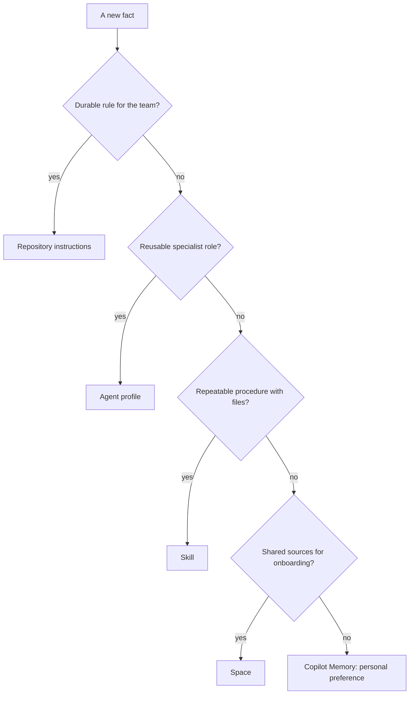

# 17. Spaces and Copilot Memory

!!! abstract "About this Lab"
    - Spaces and Memory hold context beyond a single chat.
    - Shared context belongs in the repository or a Space, personal preferences in Memory.


## 1. Copilot Spaces

- A Space is a curated collection of context for Copilot Chat.
- It can include repositories, code, pull requests, issues, free text notes and transcripts, images, and file uploads.

- Ask questions grounded in the Space, or share it with your team.
- GitHub sourced content stays in sync as the project changes.
- Spaces support onboarding and reuse because the context outlives a chat history.
- Anyone with a Copilot license, including Free, can create and use Spaces.

| Owner | Sharing options |
|-------|-----------------|
| Organization | Members get admin, editor, or viewer access, or no access |
| Individual | Public, specific users, or private; public is view only by default |

- Viewers only see sources they already have access to.
- If a Space mixes private and organization data, or data from several organizations, chat use in the cloud can be affected.

- Spaces work in Copilot Chat on GitHub, and in an IDE through the GitHub MCP server.
- Questions in a Space count as chat requests and consume credits by model and token count.

## 2. Copilot Memory

- Copilot Memory stores facts across sessions.
- It has two broad types:

| Type | Examples |
|------|----------|
| Repository level facts | Conventions, intentional patterns, build commands |
| User level preferences | Preferred review style, language, formatting |

- Memories can be created from corrections and confirmations in a session.
- They are reinforced or retired over time, with retention rules that differ by surface and plan.
- What is stored, and when Memory is used, depends on the surface and settings.
- Memory works alongside custom instructions. It does not replace them.

!!! warning "Version control is the source of truth"
    - A memory is not reviewable in a pull request and is not visible to the whole team.
    - Durable project rules belong in `AGENTS.md` and `.github/copilot-instructions.md`.
    - Use Memory for personal preferences or facts that are genuinely local to an agent.

## Reference

### Context home reference

| Destination | Put here | Version controlled | Shared |
|-------------|----------|--------------------|--------|
| Repository instructions | Durable C++ and build rules | Yes | Whole team |
| Agent profile | A role and its tool scope | Yes | Whole team |
| Skill | A packaged repeatable procedure | Yes | Whole team |
| Space | Curated sources for onboarding and reuse | No | Chosen viewers |
| Copilot Memory | Personal preferences and local agent facts | No | One user or one surface |

- Spaces work in Copilot Chat on GitHub and in an IDE through the GitHub MCP server.
- Viewers see only sources they already have access to.
- Mixing private and organization sources in one Space can affect cloud chat use.
- Memories are reinforced or retired over time. Retention differs by surface and plan.

!!! note "Version control wins"
    - A rule that must hold for every contributor belongs in `AGENTS.md` or `.github/copilot-instructions.md`.
    - Never add a secret or customer specific source to a Space or a memory.

---



## Example

```markdown
# Workshop Space

## Sources
- This repository
- docs/review-checklist.md
- Issue #1
- Pull request #4

## Tested question
"Which validation gates apply to issue #1, and where is each one defined?"
Answer names cmake --preset debug, ctest --preset debug --output-on-failure,
and docs/review-checklist.md. Every claim was checked against the source.

## Fact classification
| Fact | Home |
|------|------|
| Use cmake --preset debug before every test run | Repository instructions |
| The reviewer must not have edit tools | Agent profile |
| Always add a boundary case | Skill |
| Workshop syllabus and checklist | Space |
| I prefer findings before suggestions | Copilot Memory |
```

## 3. Summary

&emsp;✅&emsp;Use Spaces for shared, synced context that outlives chat<br>
&emsp;✅&emsp;Keep durable project rules in version controlled files<br>
&emsp;✅&emsp;Use Memory for preferences, not as a substitute for review

**Next:** [18. Inline Completions and Chat](18-Lab-Inline-Completions-and-Chat.md)
