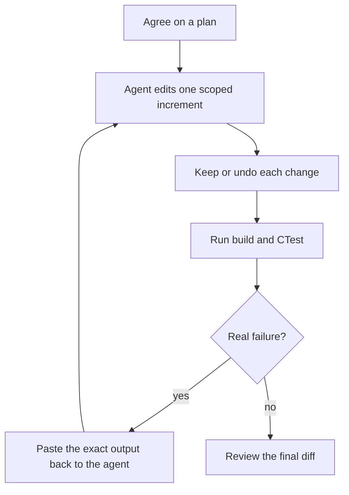

# 2. Agent Mode, Tools and MCP

!!! abstract "About this Guide"
    - Agent mode plans, edits files, runs terminal commands, and corrects itself from errors.
    - Your job is to define a definition of done that an agent can actually obey.

## 1. Plan First



- Use the Plan agent to agree on an approach before any code changes.
- The plan should name files, acceptance criteria, and validation gates.
- Reject assumptions that are not supported by the repository.

!!! tip "Executable definition of done"
    For this repository:
    ```sh
    cmake --build --preset debug
    ctest --preset debug --output-on-failure
    cmake --preset sanitizers && cmake --build --preset sanitizers
    ctest --preset sanitizers --output-on-failure
    ```

## 2. Tool Approval and Checkpoints

| Control | Why it matters |
|---------|----------------|
| Tool approval | Prevents unreviewed terminal commands or edits |
| Auto-approval rules | Reduce friction for known safe commands only |
| Request limits | Bound cost and run time |
| Todo lists | Make multi-step work visible |
| Keep or undo | Lets you reject an edit after inspection |

## 3. Feed Real Failures Back

- Paste the compiler diagnostic, not a paraphrase.
- Paste the Boost.Test failure, including file and line.
- Ask the agent to fix the failing check, not to silence it.

!!! warning "Never weaken a test"
    Changing `EXPECT`/`BOOST_CHECK` assertions or deleting a test to get a green run is a failed lab, not a passed one.

## 4. Model Context Protocol (MCP)

- MCP exposes tools, resources, and prompts to Copilot.
- Configure servers in VS Code, Copilot CLI, and the coding agent.
- The GitHub MCP server can read issues and pull requests as grounded context.

| MCP concern | Rule for the labs |
|-------------|-------------------|
| Registries | Use only approved servers |
| Allowlists | Follow the organization list |
| Credentials | Least privilege, never in prompts or files |
| Toolsets | Give each agent only what it needs |
| Outputs | Treat tool output as untrusted data |

## Reference

### Agent control reference

| Control | Where | Effect |
|---------|-------|--------|
| Tool approval | IDE or CLI setting | Confirm commands and edits before they run |
| Auto-approval rules | Editor or organization setting | Skip confirmation for known safe commands |
| Request limits | Client setting | Bound cost and run time |
| Todo list | Agent output | Makes multi-step work visible |
| Keep or undo | Chat checkpoint | Reject an edit after inspection |

### MCP rule reference

| Concern | Rule for the labs |
|---------|-------------------|
| Registries | Approved servers only |
| Allowlists | Follow the organization list |
| Credentials | Least privilege, never in prompts or files |
| Toolsets | Only the tools the task needs |
| Outputs | Treat tool output as untrusted data |

!!! note "C++ specifics"
    - Keep CMake offline and C++17. Do not add download based dependencies.
    - Respect the header and implementation split and the validation gates in `AGENTS.md`.

---

## 5. C++ Specifics

- Agent edits in `CMakeLists.txt` must keep the project offline and C++17.
- Generated code must respect the header and implementation split.
- Watch for invented STL calls and non-standard extensions.
- Run sanitizers when the toolchain supports them.

## Example

A complete IDE `mcp.json` for a read only starting point:

```json
{
  "servers": {
    "github": {
      "type": "http",
      "url": "https://api.githubcopilot.com/mcp/"
    }
  }
}
```

Use the tool picker to enable only issue read and code search for the first
task. Add a PAT and toolset header only if your approved workflow requires it.

## 6. Summary

&emsp;✅&emsp;Approve a plan before edits<br>
&emsp;✅&emsp;Use real build and test output as feedback<br>
&emsp;✅&emsp;Configure MCP under least privilege

---

**Next:** [3. Plan, Build and Validate](03-Lab-2-Plan-Build-Validate.md)
