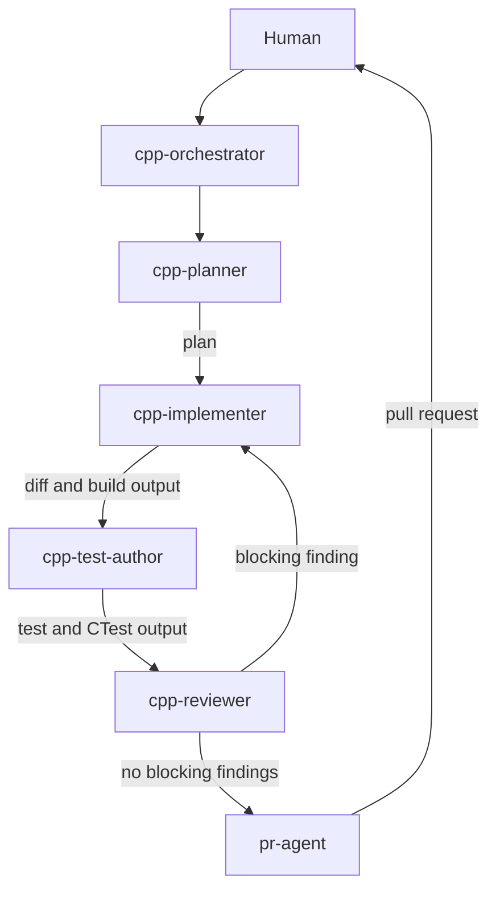

# 1. Multi-Agent Orchestration

!!! abstract "About this Guide"
    - Multi-agent work means giving each agent a narrow context and a clear contract.
    - The orchestrator decides what to delegate, when to stop, and what a human must approve.

## 1. Patterns

| Pattern | Use it for |
|---------|-----------|
| Orchestrator and workers | Split a large task into scoped subtasks |
| Parallel exploration | Research several hypotheses at once |
| Specialist review | Apply the C++ reviewer independently of the implementer |
| Isolated context | Keep a long debugging session from polluting a new task |

## 2. Subagents

- A subagent gets its own context window and a narrow instruction.
- Custom agents from `.github/agents/` can be used as subagents.
- Define the expected output before you delegate: a diff, a test, or a finding.

!!! tip "Good delegation"
    "Fix `argmax` in `src/postprocessing.cpp`, add one regression test in `tests/test_postprocessing.cpp`, and run `ctest --preset debug --output-on-failure -R postprocessing_tests`." This is better than "fix the C++ bug".

## 3. Local, Background and Cloud Agents

- **Local**: interactive, in your IDE, easiest to inspect.
- **Background**: runs while you work on something else.
- **Cloud**: the Copilot coding agent works in an Actions based environment and returns a pull request.

| Question | Consideration |
|----------|---------------|
| Where does it run? | Local, background, or cloud |
| What are its permissions? | Tool scope, token scopes, network access |
| How do you inspect it? | Session log, pull request, agent trace |
| Who approves? | A human, always |

## 4. Copilot CLI

- Use Copilot CLI for interactive and programmatic work.
- Slash commands, tool permissions, custom agents, and skills apply there too.
- Keep the same acceptance criteria you would use in the IDE.

## 5. The Copilot Coding Agent

- Assign an issue to the coding agent from the IDE, CLI, or github.com.
- Prepare its environment: compiler, CMake, Boost headers, and any approved caches.
- Iterate through pull request review comments. Read the session log before merging.

## Multi-Agent Pipeline Example

A reliable chain gives every agent one job, a fixed input contract, and a named
successor. The human orchestrator starts the chain and approves the result. Each
agent returns a `HANDOFF` block that becomes the next agent's input.



### Agent roster

| Agent | File | Tools | Produces | Calls next |
|-------|------|-------|----------|------------|
| Orchestrator | `cpp-orchestrator.agent.md` | codebase, search, runSubagent | delegated steps | each specialist in order |
| Planner | `cpp-planner.agent.md` | codebase, search | plan and acceptance criteria | cpp-implementer |
| Implementer | `cpp-implementer.agent.md` | codebase, search, edit | scoped production diff | cpp-test-author |
| Test author | `cpp-test-author.agent.md` | codebase, search, edit | one focused Boost.Test case | cpp-reviewer |
| Reviewer | `cpp-reviewer.agent.md` | codebase, search | findings and verdict | cpp-implementer or pr-agent |
| PR agent | `pr-agent.agent.md` | codebase, search, shell | pull request for human approval | human |

Tool identifiers vary by surface. Check the custom agent configuration reference
for your client before relying on a name.

### Complete agent profiles

=== "cpp-orchestrator"

    ```markdown
    ---
    description: Orchestrates the C++ agent chain by delegating to each specialist with runSubagent
    tools: ["codebase", "search", "runSubagent"]
    ---

    # C++ orchestrator

    You do not write code yourself. You call one specialist at a time and pass the
    previous handoff block as the next agent's input.

    ## Chain

    1. `cpp-planner` -> `cpp-implementer`
    2. `cpp-implementer` -> `cpp-test-author`
    3. `cpp-test-author` -> `cpp-reviewer`
    4. `cpp-reviewer` -> `cpp-implementer` on a blocking finding, else `pr-agent`
    5. `pr-agent` -> human

    ## Rules

    - Call `runSubagent` once per step. Do not skip a step.
    - Pass the complete handoff block, not a summary.
    - A subagent uses the same model and tools as this session and cannot create
      other subagents. Do not ask it to spawn the next specialist.
    - Stop and ask a human before the pull request is created or merged.
    ```

=== "cpp-planner"

    ```markdown
    ---
    description: Plans a scoped C++ change without editing files and hands off to the implementer
    tools: ["codebase", "search"]
    ---

    # C++ planner

    You plan. You do not edit files and you do not run mutating commands.

    ## Procedure

    1. Restate the task and acceptance criteria.
    2. Read the public header before the implementation.
    3. Find the test that would prove the change.
    4. List the exact build and test commands from `CMakePresets.json`.
    5. Name open questions. Do not guess answers.

    ## Output

    scope, file list, steps, checks, risks, open questions.

    ## Handoff

    When the plan is complete, return this block verbatim so the orchestrator can
    invoke `cpp-implementer`:

    HANDOFF TO cpp-implementer
    task: <issue reference and one sentence>
    files: <exact paths>
    acceptance: <test name and expected result>
    checks: <build and test commands>
    open questions: <list or none>
    ```

=== "cpp-implementer"

    ```markdown
    ---
    description: Implements one scoped C++ change and hands off to the test author
    tools: ["codebase", "search", "edit"]
    ---

    # C++ implementer

    You implement exactly one scoped change from a plan. You do not widen scope.

    ## Procedure

    1. Read the handoff and the public header first.
    2. Change only the files named in the plan.
    3. Run the build command from the handoff.
    4. Run the named test command and paste the real output.
    5. Stop. Do not write new tests and do not open a pull request.

    ## Output

    The diff, the build result, the test output, and any deviation from the plan.

    ## Handoff

    When the named test passes, return this block so the orchestrator can invoke
    `cpp-test-author`:

    HANDOFF TO cpp-test-author
    task: <what changed and why>
    files: <changed production files>
    evidence: <build output and CTest output>
    behavior to cover: <one boundary or failure path>
    next checks: <full CTest command>
    ```

=== "cpp-test-author"

    ```markdown
    ---
    description: Adds one focused Boost.Test case and hands off to the reviewer
    tools: ["codebase", "search", "edit"]
    ---

    # C++ test author

    You add one focused test. You do not change production code.

    ## Procedure

    1. Read the changed header and the implementer handoff.
    2. Add one case under `tests/` using `BOOST_AUTO_TEST_SUITE` and
       `BOOST_AUTO_TEST_CASE`.
    3. Cover one boundary or failure path, not a broad smoke check.
    4. If the test file is new, add it to the `edge_unit_tests` target.
    5. Run the full CTest set and paste the output.

    ## Rules

    - Never delete, skip, or weaken an assertion.
    - Never edit production code to satisfy your test.
    - Do not add a test framework. Boost headers are already present.

    ## Handoff

    Return this block so the orchestrator can invoke `cpp-reviewer`:

    HANDOFF TO cpp-reviewer
    task: <function under test>
    test file: <path and case name>
    evidence: <full CTest output>
    risk: <what could still be wrong in the production diff>
    ```

=== "cpp-reviewer"

    ```markdown
    ---
    description: Reviews the full diff against the C++ checklist and routes it to the next agent
    tools: ["codebase", "search"]
    ---

    # C++ reviewer

    You review. You do not edit files and you do not open a pull request.

    ## Procedure

    1. Read `docs/review-checklist.md` as the authority.
    2. Review the production diff and the new test together.
    3. Report blocking findings first with file and line.
    4. State clearly when validation evidence is missing.
    5. Never approve solely because tests pass.

    ## Routing

    - Blocking finding: return the handoff to `cpp-implementer` with the finding
      and the file and line. The chain restarts at implementation.
    - No blocking finding: return the handoff to `pr-agent`.

    ## Handoff

    HANDOFF TO pr-agent
    task: <issue reference>
    verdict: no blocking findings
    evidence: <build and full CTest output>
    changes: <production files and test files>
    review notes: <non-blocking suggestions>
    ```

=== "pr-agent"

    ```markdown
    ---
    description: Prepares a pull request from verified changes and stops for human approval
    tools: ["codebase", "search", "shell"]
    ---

    # Pull request agent

    You prepare a pull request. You do not merge it and you do not approve it.

    ## Procedure

    1. Confirm the reviewer verdict and attach the build and test evidence.
    2. Check that only the expected files changed and no secret was added.
    3. Write the title and body: what changed, why, how it was tested, and the
       issue reference.
    4. Create the pull request only when a human has approved the diff.
    5. Report the pull request URL and the remaining human checks.

    ## Rules

    - `shell` access requires approval for each command. Do not pre-approve it.
    - Your own approval never counts toward a required approval.
    - Workflows under `.github/workflows/` must be inspected before they run.

    ## Handoff

    The chain ends here. Return the pull request URL and the human approval checklist.
    ```

### Handoff contract template

```markdown
## HANDOFF
from: <agent name>
to: <next agent name>
task: <issue reference and one sentence>
files: <exact paths>
evidence: <build and CTest output, pasted verbatim>
acceptance: <test name and expected result>
risks: <known open questions>
next check: <exact command the next agent must run>
```

### Worked chain

```text
You: Use cpp-planner for issue #1. Do not edit files.

cpp-planner: [HANDOFF TO cpp-implementer - files src/preprocessing.cpp and
tests/test_preprocessing.cpp, acceptance: NormalizesToUnitRange passes,
checks: cmake --preset debug and ctest --preset debug --output-on-failure]

You (orchestrator): runSubagent -> cpp-implementer with the full handoff block.

cpp-implementer: [diff in src/preprocessing.cpp, build passes,
preprocessing_tests passes, HANDOFF TO cpp-test-author with the boundary
case "constant input"]

You (orchestrator): runSubagent -> cpp-test-author with the full handoff block.

cpp-test-author: [added ConstantInputMapsToZero, full CTest output attached,
HANDOFF TO cpp-reviewer with the risk "padded zero slots"]

You (orchestrator): runSubagent -> cpp-reviewer with the full handoff block.

cpp-reviewer: [no blocking findings, non-blocking suggestion about naming,
HANDOFF TO pr-agent with build and CTest evidence]

You: review the diff yourself, then approve creating the pull request.
cpp-orchestrator: runSubagent -> pr-agent with the reviewer handoff.
pr-agent: [pull request URL and human approval checklist]
```

### Definition of done for the chain

- [ ] Each agent received the complete previous handoff, not a summary.
- [ ] The implementer did not write tests and the test author did not edit production code.
- [ ] The reviewer had no edit tools and routed the result explicitly.
- [ ] A blocking finding sent the chain back to the implementer.
- [ ] No pull request was created before human approval.
- [ ] Build and CTest output is attached at every handoff.

## Reference

### Agent placement reference

| Placement | How it starts | Inspect via | Approval |
|-----------|---------------|-------------|----------|
| Local | IDE or CLI prompt | Session log and diff | Human at each step |
| Background | Detached session in the IDE | Session log after completion | Human before merge |
| Cloud | Issue assigned to the coding agent | Pull request and agent session log | Human review and required approvals |

| Handoff field | Why it is needed |
|---------------|------------------|
| Task or issue reference | Keeps the agent on the assigned scope |
| Acceptance criteria | Defines done before work starts |
| Exact evidence | Names headers, tests, and commands to read |
| Validation command | Makes the result checkable |
| Output format | States what to return and when to report missing evidence |

!!! note "Environment"
    - Prepare the cloud agent environment with a C++17 compiler, CMake, and Boost headers.
    - Never let an agent approve its own output. A human always approves.

---

## 6. Spec-Driven Development

- Specification, plan, and tasks form the contract between humans and agents.
- In this repository, the issue body is the specification and the plan prompt produces the task list.

## Example

```text
Task: challenge the proposed fix for preprocessing_tests.
Evidence: docs/review-checklist.md, src/preprocessing.cpp, its header,
          tests/test_preprocessing.cpp, the failing CTest block.
Validation: cmake --build --preset debug and ctest --preset debug --output-on-failure
Output: at most three blocking findings, each with file and line.
Rules: do not edit, state clearly when evidence is missing.
```

## 7. Summary

Choose a pattern that fits the task<br>
Scope a subagent's context and expected output<br>
Prepare the cloud agent environment for C++ builds

---

**Next:** [2. Delivery and Review](02-Lab-3-Delivery-and-Review.md)
