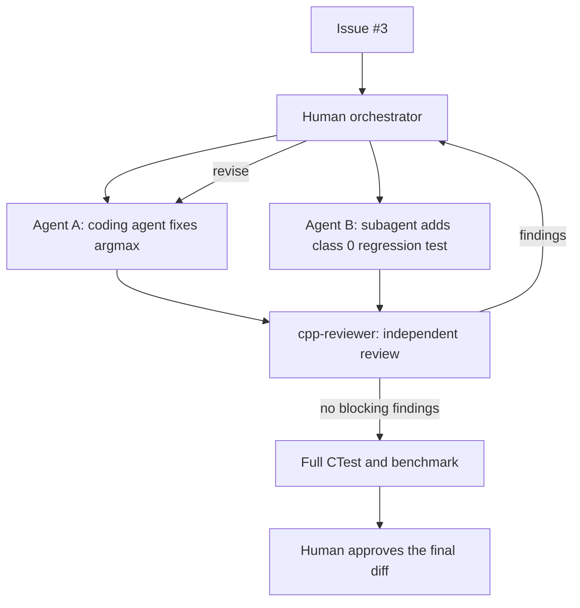

# 2. Delivery and Review

!!! abstract "About this Lab"
    - The argmax defect is defined by a failing test and a two-agent workflow.
    - Delivery evidence shows what each worker proposed and what a human approved.


## 1. Problem Statement



- `argmax` starts its search at index 1.
- A highest score in class 0 is ignored, so `PostprocessingTest.ArgmaxIncludesFirstClass` fails.

## Reference

### Delivery evidence reference

| Artifact | Where it comes from | Why keep it |
|----------|---------------------|-------------|
| Issue #3 | Repository issues | The specification for the task |
| Agent output | Coding agent pull request or subagent result | What each worker proposed |
| Review comments | `.github/agents/cpp-reviewer.agent.md` checklist | Independent findings |
| Session log or trace | Agent run | Shows what the agent actually did |
| Final diff | Branch | The change a human approves |
| Test summary and benchmark | CTest and `edge_benchmark` | Behavior evidence |

- Check ownership, bounds, integer width, and API stability before approving.
- Do not change preprocessing in this lab and do not weaken the existing test.
- Treat the empty-input guard as part of the contract.

```sh
ctest --preset debug --output-on-failure
./build/debug/edge_benchmark data/valid.json 2000
```

---

## Example

```text
Reviewer: cpp-reviewer agent, read only tools
Diff: src/postprocessing.cpp, tests/test_postprocessing.cpp

Blocking:
  1. src/postprocessing.cpp:14 - index without a bounds check.

Non-blocking:
  1. tests/test_postprocessing.cpp:12 - add a constant-input case.

Evidence:
  cmake --build --preset debug -> pass
  ctest --preset debug --output-on-failure -> 3/3 pass

Verdict: human approves after the blocking finding is addressed.
```

---

**Next:** [3. Trust, Security and Measurement](03-Trust-Security-Measurement.md)
