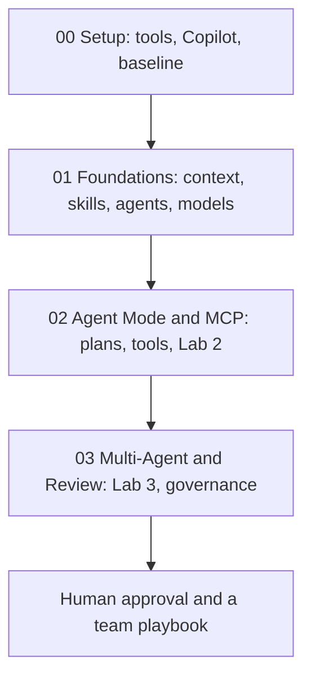

# AI-Assisted Development with GitHub Copilot - C++ Labs

* A full-day, hands-on workshop for C++ development teams.
* **GitHub Copilot is the subject**. C++ is the working codebase: every demo and lab runs against the small CMake project in this repository.
* C++ knowledge is assumed. **No time is spent teaching C++ syntax.**

---

## Lab Series

| Lab | Title                                                          | Description                                                                                                                                                             |
| --- | -------------------------------------------------------------- | ----------------------------------------------------------------------------------------------------------------------------------------------------------------------- |
| 000 | [Setup](./00-Setup/README.md)                                   | Install tools, configure Copilot, and verify the starter repository                                                                                                     |
| 001 | [Copilot Foundations](./01-Copilot-Foundations/README.md)       | Alignment, context, and 15 feature labs: skills, agents, models, debugging, usage review, code review, prompts, MCP, modes, delegation, CLI, hooks, Spaces, completions |
| 002 | [Agent Mode and MCP](./02-Agent-Mode-and-MCP/README.md)         | Models, agent mode, MCP, Lab 2                                                                                                                                          |
| 003 | [Multi-Agent and Review](./03-Multi-Agent-and-Review/README.md) | Subagents, coding agent, AI code review, Lab 3                                                                                                                          |

## Learning Objectives

Use Copilot surfaces deliberately: completion, chat, Edit, Agent, and Plan 
Engineer context with instructions, `AGENTS.md`, and prompt files 
Build custom agents and Agent Skills for a C++ team workflow 
Select models and drive agent mode with validation gates 
Extend Copilot with MCP under least-privilege access 
Orchestrate multi-agent delivery and review generated C++ diffs 
Measure, govern, and keep a human in the loop 
Use agent skills, custom agents, prompt files, and hooks for repeatable work 
Debug with real build output and review Copilot generated diffs and pull requests 
Review adoption, credits, and policy changes from administrator views

## The Starter Repository

The code next to this site is the prepared workshop repository:

| Path                                  | Purpose                                                                  |
| ------------------------------------- | ------------------------------------------------------------------------ |
| `include/edge_inference/`, `src/` | Small C++17 inference library with a deterministic reference backend     |
| `cli/`                              | Command line tool that runs one input through the inference path         |
| `benchmark/`                        | Latency benchmark with p50 and p95 reporting                             |
| `tests/`                            | Boost.Test suites with two seeded failures for Lab 2 and Lab 3           |
| `data/`                             | Valid, boundary, and invalid input samples                               |
| `.github/`                          | Copilot instructions, path rules, prompts, a reviewer agent, and a skill |

!!! warning "Seeded failures are intentional"
    - A clean checkout builds successfully but `preprocessing_tests` and `postprocessing_tests` fail.
    - Those failures are the starting points for Lab 2 and Lab 3.
    - `model_tests` passes from the start.

## How to Use These Labs

1. Start with **Lab 000** and verify your local environment.
2. Work through the labs in order. Each lab folder has an overview page and numbered steps.
3. Clone this repository and keep your work on a lab branch.
4. Follow the **definition of done** in each lab. Build and test output is evidence.

---

**Happy coding with Copilot!**
